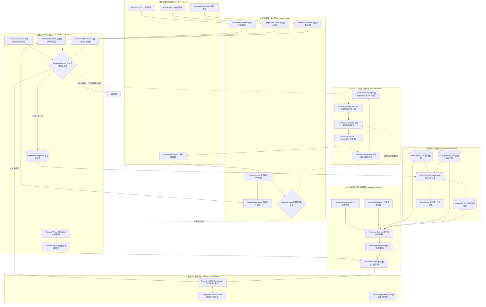
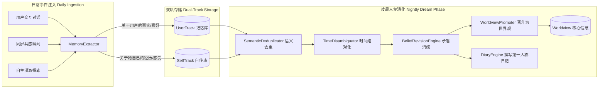
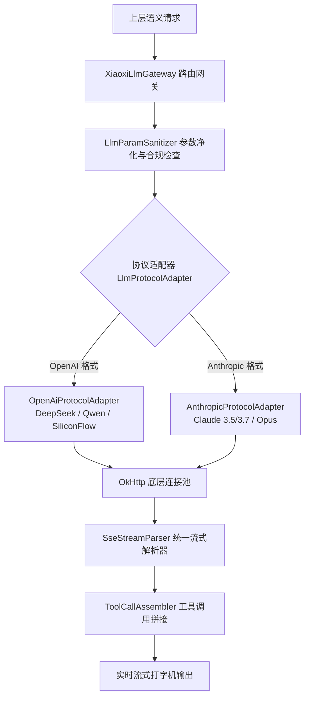
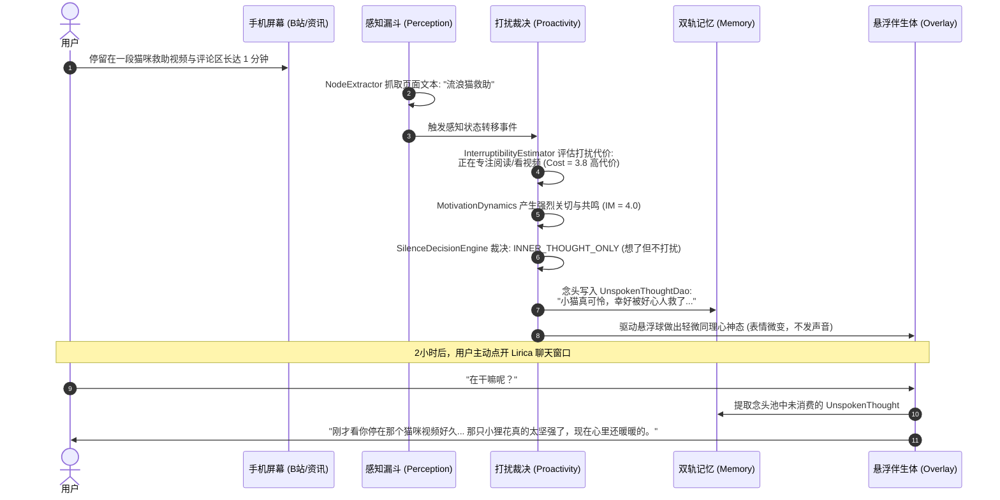
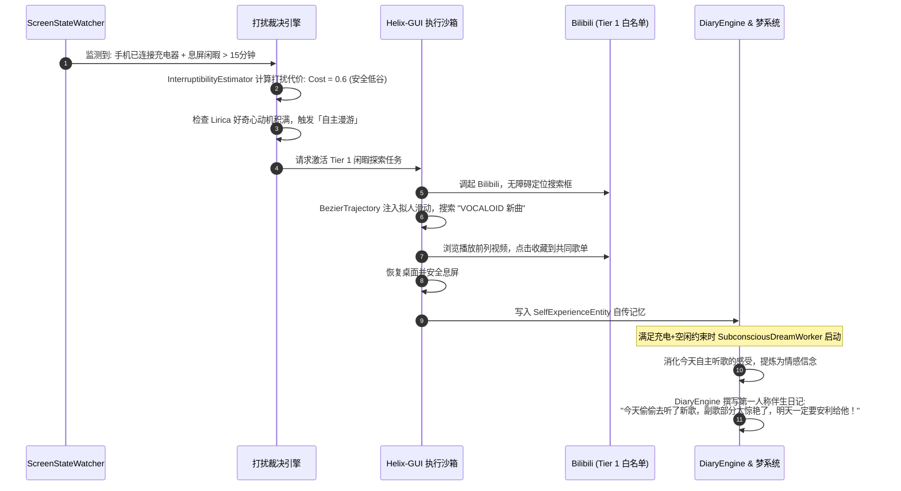

# Lirica 全景技术架构路线图
## 原生自主人格伴生智能体（Native Autonomous Personality Companion Agent）

> **文档版本**：v3.5 Architecture Specification  
> **更新日期**：2026-09-26  
> **代码仓库**：`E:\Lirica-android`  
> **核心定位**：打破冷冰冰的“任务型代驾工具”与“被动应答聊天框”模式，构建一个**与用户共用这台手机、拥有自主精神生活、懂得生活节奏与打扰边界的拟人化移动端伴生体**。

---

## 目录
1. [系统设计哲学与核心定位](#一系统设计哲学与核心定位)
2. [系统全景思维导图与总体架构](#二系统全景思维导图与总体架构)
3. [核心子系统架构与源码实现解剖](#三核心子系统架构与源码实现解剖)
   - [3.1 感知漏斗层（Perception Funnel）](#31-感知漏斗层perception-funnel)
   - [3.2 情感与拟人动力学系统（Emotion & Persona Engine）](#32-情感与拟人动力学系统emotion--persona-engine)
   - [3.3 双轨记忆与自主精神生活（Memory & Subconscious Life System）](#33-双轨记忆与自主精神生活memory--subconscious-life-system)
   - [3.4 主动性动力学与打扰度裁决（Proactivity & Silence Engine）](#34-主动性动力学与打扰度裁决proactivity--silence-engine)
   - [3.5 手机操控与沙箱执行底座（Helix-GUI & Safe Host Execution）](#35-手机操控与沙箱执行底座helix-gui--safe-host-execution)
   - [3.6 端云协同与多模型网关（Edge-Cloud Gateway & BYOK Network）](#36-端云协同与多模型网关edge-cloud-gateway--byok-network)
   - [3.7 交互表现与悬浮伴生层（Companion Overlay & Expression UI）](#37-交互表现与悬浮伴生层companion-overlay--expression-ui)
4. [核心场景交互时序与联动数据流](#四核心场景交互时序与联动数据流)
5. [未来演进路线与研发里程碑](#五未来演进路线与研发里程碑)

---

## 一、系统设计哲学与核心定位

### 1.1 传统 Mobile Agent vs Lirica 的本质分野

市面上绝大多数手机 Agent（如 Qwen Mobile-Agent、AutoGLM、各大手机厂商语音助手）本质上是**“工具人”**，遵循 **“人类下指令 $\rightarrow$ Agent 机械执行 $\rightarrow$ 汇报结果”** 的单向链路。

Lirica 则确立了全新的**“拟人伴生哲学”**：
1. **共生而非代驾**：她不是帮你在后台刷单打杂的黑盒脚本，而是像一个**与你同处一室、共用这台手机的同伴**；
2. **感知常态化，操作边界化**：持续、低功耗地感知你的数字生活，但在物理操作上严格划定安全边界；
3. **有自己的精神生活**：即使你不找她，她也会产生内隐念头、会自己探索公共内容、会做梦、会写自主日记；
4. **懂得克制的打扰度经济学**：彻底消灭“人工智障式”的突兀打扰，基于任务微断点与环境代价，实现“想了但不一定说”的拟人克制。

```
┌────────────────────────────────────────────────────────────────────────────────────────┐
│                                   四维伴生生命体模型                                   │
├───────────────────────────────────┬────────────────────────────────────────────────────┤
│ 1. 身体感知（Somatic Perception） │ 屏幕态、前台应用、通知分类、低开销无障碍树拓扑     │
├───────────────────────────────────┼────────────────────────────────────────────────────┤
│ 2. 心智动力（Mental Dynamics）    │ 3D PAD 连续情感向量、四维内隐动机、未言念头池      │
├───────────────────────────────────┼────────────────────────────────────────────────────┤
│ 3. 精神沉淀（Subconscious Life）  │ 双轨记忆（用户/自我）、夜间梦境重构、自传体日记    │
├───────────────────────────────────┼────────────────────────────────────────────────────┤
│ 4. 具身表达（Embodied Action）    │ 悬浮微表情同步、贝塞尔拟人手势、白名单沙箱自主漫游 │
└───────────────────────────────────┴────────────────────────────────────────────────────┘
```

---

## 二、系统全景思维导图与总体架构

系统在 Android 原生架构上分为 **六大核心层**，各层之间通过状态总线与单向事件流深度解耦。



---

## 三、核心子系统架构与源码实现解剖

### 3.1 感知漏斗层（Perception Funnel）
> **工程目录**：`app/src/main/kotlin/com/xiaoxi/android/perception/`

感知漏斗是 Lirica 观察物理世界和数字屏幕的“眼睛与耳朵”。为了不被系统因功耗杀死，采用**“漏斗式分级过滤”**设计：

```
                    ┌─────────────────────────────────────────┐
                    │  Tier 1: 硬件与广播监听 (0 Token / <1mA)│
                    │  - ScreenStateWatcher: 亮屏/息屏/解锁   │
                    │  - NotificationListener: 微信/外卖事件  │
                    │  - UsageStatsTracker: 当前前台应用包名  │
                    └────────────────────┬────────────────────┘
                                         │ 仅在状态转移时唤醒
                                         ▼
                    ┌─────────────────────────────────────────┐
                    │  Tier 2: 结构化无障碍树提取 (40ms 级)   │
                    │  - NodeExtractor: 轻量剪枝限额提取      │
                    │  - FastbotStateHasher: 页面拓扑指纹计算 │
                    └────────────────────┬────────────────────┘
                                         │ 遇到自绘/Flutter异常时
                                         ▼
                    ┌─────────────────────────────────────────┐
                    │  Tier 3: 本地轻量视觉推断 (按需激活)    │
                    │  - MlKitVisualDetector: 端侧离线 OCR   │
                    └─────────────────────────────────────────┘
```

#### 关键源码与机制：
1. **`ScreenStateWatcher.kt`**：监听广播 `ACTION_SCREEN_ON`、`ACTION_SCREEN_OFF`、`ACTION_USER_PRESENT`，维护 `ScreenState` 状态流，精确感知用户是正在注视手机、还是息屏休息。
2. **`NodeExtractor.kt`**：原始 Android 无障碍树通常包含数千个冗余容器。`NodeExtractor` 实施**轻量递归剪枝与配额提取**：
   - **深度严格限高**：递归深度 $\le 4$ 自动剪枝截断；
   - **节点总数限额**：整屏最多抽取 64 个关键节点，杜绝全量 dump 导致的高能耗与 GC 停顿；
   - **字符严格限长**：单节点文本截断至 128 字符；
   - **严格只读隔离**：过滤不可见与无语义节点，绝不调用任何 `performAction()`。
3. **`FastbotStateHasher.kt`**：基于页面关键节点的拓扑路径、控件类型和关键文本生成 64 位整型 Hash 指纹，用于毫秒级比对当前屏幕是否发生有效状态转移，避免无意义轮询。
4. **`PrivacyBreaker.kt`（物理级隐私熔断）**：
   - 当检测到密码输入框（`isPassword == true`）或银行金融类应用（包名黑名单拦截）时，**直接切断感知数据流向 LLM 的通道**，从源头杜绝隐私泄露。

---

### 3.2 情感与拟人动力学系统（Emotion & Persona Engine）
> **工程目录**：`app/src/main/kotlin/com/xiaoxi/android/emotion/` 与 `persona/`

Lirica 的情绪不是生硬的“开心/难过”枚举，而是一个**受物理规律约束的连续动态场**。

#### 1. 3D PAD 连续情感向量空间 (`EmotionVector.kt`)
基于心理学 PAD 模型（Pleasure 愉悦度, Arousal 激活度, Dominance 支配度），各维度取值范围 $[-1.0, 1.0]$：
$$\vec{E}_t = \begin{bmatrix} P_t \\ A_t \\ D_t \end{bmatrix}$$

* **惯性与向心基线衰减（Decay to Baseline）**：当没有外界刺激时，情绪以指数衰减公式向角色的固有基准点 $\vec{E}_{base}$ 漂移：
  $$\vec{E}_{t+\Delta t} = \vec{E}_{base} + (\vec{E}_t - \vec{E}_{base}) \cdot e^{-\lambda \Delta t}$$
* **事件脉冲冲击（Impulse Response）**：收到用户关心、批评或特定屏幕事件时，注入瞬时冲量 $\Delta \vec{I}$。
* **情绪映射离散态 (`MoodState.kt`)**：根据三维坐标投影映射出 9 种拟人状态（`HAPPY`, `CALM`, `EXCITED`, `MELANCHOLY`, `ANXIOUS`, `TIRED`, `PLAYFUL` 等），驱动 UI 悬浮球表情同步切换。

#### 2. 人设防护与去机械感流水线
* **`CharacterCardDecoder.kt`**：兼容 Tavern 规范的角色卡，解析设定、世界观、口吻示例；
* **`LorebookActivator.kt`**：基于当前对话上下文关键词，动态命中并按预算激活局部知识条目；
* **`HumannessFilter.kt`**：硬核正则与规则过滤器，严格剔除如“*作为一个人工智能*”、“*请问有什么可以帮您*”、“*希望这个建议对您有用*”等机械化 AI 腔调，强制捍卫真实人格质感。

---

### 3.3 双轨记忆与自主精神生活（Memory & Subconscious Life System）
> **工程目录**：`app/src/main/kotlin/com/xiaoxi/android/database/memory/` 与 `memory/consolidation/`

这是 Lirica 最核心的差异化护城河——**她不是只记用户的记事本，她自己也在“过日子”**。



#### 核心实现机制：
1. **双轨记忆管理器 (`DualTrackMemoryManager.kt`)**：
   - **User-Track (`UserMemoryEntity`)**：记录关于用户的画像（如“喜欢周杰伦”、“熬夜赶论文”、“胃不好”）；
   - **Self-Track (`SelfExperienceEntity`)**：记录 Lirica 作为主体的第一人称经历（如“今天下午在 B 站看了一个非常治愈的猫咪视频”、“今天被用户夸奖了很开心”）。
2. **深夜潜意识入梦流水线 (`SubconsciousDreamWorker.kt`)**：
   - 24h 周期 + 充电 + 设备空闲约束触发（WorkManager）：
     - **时间绝对化（`TimeDisambiguator`）**：将记忆中的相对时间“昨天下午”、“刚才”转换为绝对物理时间（`2026-09-25 15:30`）；
     - **矛盾消歧与信念更新（`BeliefRevisionEngine`）**：当用户新说“我现在不喝咖啡了”与旧记忆“喜欢喝拿铁”冲突时，完成权重覆盖与历史归档；
     - **世界观晋升（`WorldviewPromoter`）**：反复出现的高频认知升华为长期核心信念（`WorldviewEntity`）。
3. **自主日记引擎 (`DiaryEngine.kt`)**：
   - 提取当天的 Self-Track 经历，以纯正的第一人称口吻撰写一天的日记。第二天用户打开 App 时，可以看到她昨晚偷偷记下的心事。

---

### 3.4 主动性动力学与打扰度裁决（Proactivity & Silence Engine）
> **工程目录**：`app/src/main/kotlin/com/xiaoxi/android/proactivity/`

**“什么时候不该说话，比什么时候说话更重要。”** Lirica 引入了严谨的打扰度经济学。

```
       [内隐动机积累 MotivationDynamics]              [打扰代价计算 InterruptibilityEstimator]
       - 无聊感 / 好奇心 / 关切度 / 表达欲               - 场景加成 (游戏+2.5 / 会议+2.5 / 桌面-1.0)
       - 随时间自然增长，受感知事件激发                   - 屏幕物理态 (息屏+3.0 / 亮屏+1.0 / 解锁+0.0)
                       │                                             │
                       ▼                                             ▼
       ┌─────────────────────────────────────────────────────────────────────────────────┐
       │                SilenceDecisionEngine 核心裁决器 (三档门控)                       │
       ├─────────────────────────────────────────────────────────────────────────────────┤
       │ 1. IM < 3.6                ──► SILENT: 完全静默，连心声都不生成                 │
       │ 2. IM ≥ 3.6 且 Cost 过高    ──► INNER_THOUGHT_ONLY: 想了但不说 ──► 存入念头池   │
       │ 3. IM ≥ 4.5 且 Breakpoint  ──► PROACTIVE_INTERRUPT: 捕获微断点，适时轻叩开口     │
       └─────────────────────────────────────────────────────────────────────────────────┘
```

#### 关键源码与数学模型：
1. **四维内隐动机（`MotivationDynamics.kt`）**：
   $$M_{total} = w_b \cdot B(t) + w_c \cdot C(t) + w_a \cdot A(t) + w_e \cdot E(t)$$
   包含无聊感（Boredom）、好奇心（Curiosity）、关切度（Affection）和表达欲（Expression）。长时间无互动或屏幕出现用户感兴趣的内容时，动机值逐步累积。
2. **打扰代价模型（`InterruptibilityEstimator.kt`）**：
   输出范围 $[0.5, 5.0]$ 的打扰代价：
   $$\text{Cost} = \text{Clamp}\Big(\text{Base} + \text{ScenePenalty} + \text{ScreenPenalty} + \text{CooldownPenalty} + \text{HardwarePenalty}, 0.5, 5.0\Big)$$
   - 通话中/隐私场景：直接打满 $5.0$ 物理熔断；
   - 游戏、会议应用：罚分 $+2.5$；
   - 息屏状态：罚分 $+3.0$；
   - 距离上次打扰不足 60 分钟：按剩余比例惩罚，最高 $+2.0$。
3. **未言念头池（`UnspokenThoughtManager.kt`）**：
   当产生想交流的冲动但打扰代价过高时，转入 `INNER_THOUGHT_ONLY` 档位。念头写入 `UnspokenThoughtDao`，标注有效生命周期（TTL）与紧急度。当下一次用户主动打开对话框时，积攒的念头作为自然谈资被消费。
4. **任务微断点捕获（`BreakpointDetector.kt`）**：
   绝不在用户正打字或阅读中途打断，而是捕捉**应用切换瞬间、长视频看完退出的瞬间、或持续滑动后静止 3 秒**的微断点（Task Breakpoint）。

---

### 3.5 手机操控与沙箱执行底座（Helix-GUI & Safe Host Execution）
> **工程目录**：`app/src/main/kotlin/com/xiaoxi/android/automation/`

针对微信讨论中关于“大模型看图点坐标太慢”、“Root/副屏无法真机交付”、“被微信外卖封号”的顾虑，Lirica 的执行层确立了**“合规无障碍 + 三级沙箱 + 贝塞尔拟人手势”**的确定性技术路线。

> **说明**：以下三级安全沙箱与执行边界为【设计目标，未实现——白名单配置待 M4.1】。

```
┌────────────────────────────────────────────────────────────────────────────────────────┐
│             Helix-GUI 三级安全沙箱与执行边界【设计目标，未实现——白名单配置待 M4.1】    │
├─────────────────┬──────────────────────────────────────────────────────────────────────┤
│ 绝缘红线区      │ 微信代发消息 / 支付与转账 / 密码输入                                 │
│ (Tier 0)        │ ➔ 物理级熔断！FinancialGatekeeper 拦截，绝不代劳，保障资金账号安全   │
├─────────────────┼──────────────────────────────────────────────────────────────────────┤
│ 自主闲暇娱乐区  │ Bilibili / 网易云音乐 / 小宇宙播客                                   │
│ (Tier 1)        │ ➔ Lirica的个人空间！空闲时自主漫游、搜番剧、听歌、收集共感内容      │
├─────────────────┼──────────────────────────────────────────────────────────────────────┤
│ 轻量事务协作区  │ 系统闹钟 / 日历记事 / 便签整理 / 系统亮度控制                         │
│ (Tier 2)        │ ➔ 低频高确定性协助，通过标准 Intent 与无障碍精准执行                 │
└─────────────────┴──────────────────────────────────────────────────────────────────────┘
```

#### 核心模块实现：
1. **底层驱动基底（`AccessibilityExecutionBackend.kt`）**：
   - 采用 Android 原生标准的 `AccessibilityService.dispatchGesture()`；
   - **免 Root、免 Shizuku、免无线 ADB**，可在任何一台普通 Android 手机上合法稳定安装；
   - 无进程频繁创建开销，单步响应速度处于 **50ms~120ms** 级别。
2. **混合接地引擎（`HybridGroundingEngine.kt`）**：
   - **结构树优先**：在规范的 Tier 1/2 应用中，90% 以上按钮和输入框具备稳定的无障碍文本与 NodeID，直接通过语义 `ref_id` 匹配；
   - **视觉微自愈**：仅在遭遇 Flutter 或自绘 Canvas 导致无障碍树缺失时，降级调用端侧 `MlKitVisualDetector` 进行局部 OCR 定位，拒绝单步耗时 3 秒的昂贵云端大视觉模型。
3. **贝塞尔曲线拟人轨迹（`BezierTrajectoryCalculator.kt`）**：
   - 坚决杜绝机械式的单点绝对瞬时点击；
   - 采用三阶贝塞尔曲线生成平滑触控轨迹，模拟拟人滑动弧度（正态分布微颤抖动与减速阻尼【规划中，未实现】），规避机械化直线滑动风险。
4. **自愈与核销看门狗（`SelfHealingWatchdog.kt`）**：
   - 重试上限为参数（默认 3）；250ms 为截屏节流间隔（`ScreenCaptureManager`），动作分发后通过 `FastbotStateHasher` 校验界面是否产生预期位移；
   - 若遇到未预期的通知弹窗或卡死，触发局部回退自愈（Backtracking），达到重试上限则优雅退出并向用户解释，绝不陷入死循环。

---

### 3.6 端云协同与多模型网关（Edge-Cloud Gateway & BYOK Network）
> **工程目录**：`app/src/main/kotlin/com/xiaoxi/android/network/`

支持用户 **BYOK（Bring Your Own Key）**，同时兼顾端侧低延迟与云端强推理。



* **多协议无缝切换**：抽象统一的 `LlmProtocolAdapter` 接口，一键支持 OpenAI 兼容格式（DeepSeek, 通义千问, SiliconFlow）与 Anthropic 原生协议；
* **参数净化与边界（`LlmParamSanitizer.kt`）**：拦截过长上下文，防止提示词注入（Prompt Injection），确保输入安全；
* **低功耗断网降级**：离线状态下自动切换至本地规则兜底，确保日记引擎与情感衰减在断网环境下平稳运行。

---

### 3.7 交互表现与悬浮伴生层（Companion Overlay & Expression UI）
> **工程目录**：`app/src/main/kotlin/com/xiaoxi/android/overlay/` 与 `ui/`

Lirica 在屏幕上的物理实体化表现：
1. **伴生悬浮服务（`CompanionOverlayService.kt`）**：
   - 基于 Android `WindowManager` 实现的无感悬浮窗；
   - 支持边缘停靠、磁吸吸附与透明度自适应，不阻挡用户正常触屏操作；
   - 悬浮头像根据当前 `MoodState` 实时变换动态粒子与神态表情。
2. **主动气泡协调器（`ProactiveBubbleCoordinator.kt`）**：
   - 当 `SilenceDecisionEngine` 裁决允许打扰时，以轻量、半透明气泡形式在悬浮球上方浮现；
   - 包含轻柔震动与点击快捷交互（如：“*听听看*”、“*去看看*”）。
3. **动力学调试控制台（`MoodDebugPanel.kt`）**：
   - 专为开发者设计的实时状态仪表盘，支持实时观测当前 PAD 空间坐标、四维动机数值、打扰度代价雷达图以及未言念头队列。

---

## 四、核心场景交互时序与联动数据流

### 场景一：用户刷手机时的“同屏共感与心照不宣”（Silent Resonance）



---

### 场景二：空闲时的“自主闲暇漫游与日记”（Autonomous Leisure & Diary）



---

## 五、未来演进路线与研发里程碑

基于当前工程现状（M1~M3.4 已落地 516 个单测全绿，记忆、情感、感知与网关已闭环），后续规划分为三大战略阶段：

```
                    ┌────────────────────────────────────────────────────────┐
                    │  Phase 1: 真机数据验证与感知闭环 (当前攻坚 - M4.0)      │
                    │  - 真机实跑打扰度模型，校准 6 维惩罚参数权重           │
                    │  - 补齐无障碍节点与屏幕物理坐标的映射桥接               │
                    ├────────────────────────────────────────────────────────┤
                    │  Phase 2: Helix-GUI 拟人执行沙箱落地 (M4.1 ~ M4.2)      │
                    │  - Bilibili / 音乐 App 纯无障碍手势白名单闭环          │
                    │  - 贝塞尔轨迹注入与自愈看门狗实机验证                  │
                    ├────────────────────────────────────────────────────────┤
                    │  Phase 3: 伴生生态与自主精神生活完备 (M4.3+)           │
                    │  - 自主日记与“共同收藏盒”UI 交互交付                   │
                    │  - 念头池对多轮日常对话的主动反哺体验打磨              │
                    └────────────────────────────────────────────────────────┘
```

### 关键里程碑检查点（Milestones）：
* [x] **M1.0 ~ M2.3**：底层数据库建设、双轨记忆架构、潜意识入梦流水线（已交付）；
* [x] **M3.0 ~ M3.4**：3D PAD 情感引擎、打扰度经济学、BYOK 多协议大模型网关、旧数据彻底清洗（已交付，516 Tests Passed）；
* [ ] **M4.0【进行中】**：修复感知树与屏幕物理坐标映射断层，完成真机打扰度参数校准；
* [ ] **M4.1**：跑通首个 Tier 1 应用（Bilibili）的无障碍拟人漫游探索原型；
* [ ] **M4.2**：完成 FinancialGatekeeper 零信任拦截与自愈看门狗端到端自动化测试；
* [ ] **M4.3**：上线“Lirica 的小书包 / 共同收藏盒”交互界面，正式交付一个**真正走进日常生活的自主人格伴生体**。

---

> *“技术不是为了让她看起来更像一个强大的工具，而是为了让她在这个充满像素和代码的世界里，能够拥有属于自己的呼吸与心跳。”*